# ActionPulse: AI-Powered Meeting-to-Action Converter
## Comprehensive Project Summary, Architecture & Team Contribution Report

---

## 1. Executive Summary & Project Vision

**ActionPulse** is an enterprise-grade, zero-budget AI platform designed to transform multi-speaker meeting discussions into verifiable, grounded, and executable task pipelines. Instead of requiring project managers to manually take notes, copy-paste transcripts, or track follow-ups, ActionPulse provides a zero-touch pipeline: from real-time meeting ingestion, AI audio diarization, and structured action item extraction, to dependency-aware Kanban tracking and multi-channel notification dispatch.

### Core Architectural Pillars
* **Frontend:** Vite + React (TypeScript), Tailwind CSS with a Notion/Linear-inspired dark aesthetic (`#060608`), and real-time state synchronization.
* **Backend:** FastAPI (Python 3.11/3.12) containerized with modular domain routers and asynchronous background processing.
* **Database & Auth:** Supabase PostgreSQL with strict Row Level Security (RLS), custom PostgreSQL schemas, and real-time WebSocket subscriptions.
* **AI & Intelligence:** Multi-LLM hybrid architecture combining AWS Bedrock (Claude / Titan) with Google Gemini 3.1 Flash-Lite, strictly enforcing zero-budget constraints.

---

## 2. End-to-End System Architecture

```mermaid
flowchart TD
    subgraph Ingestion["1. Meeting Ingestion Layer"]
        A1["Zoom Cloud Webhook"]
        A2["Google Meet API"]
        A3["MS Teams Graph API"]
        A4["In-App Audio Recorder (WAV)"]
        A5["Manual Upload (.VTT, .TXT, .DOCX)"]
    end

    subgraph Processing["2. Processing & Diarization"]
        B1["FastAPI Webhook Listeners"]
        B2["Diarization Worker (Kaggle/Colab/Space)"]
        B3["Multi-Speaker VTT Parser & Canonical Normalizer"]
    end

    subgraph Intelligence["3. AI Extraction & Copilot Layer"]
        C1["Gemini 3.1 Flash-Lite / AWS Bedrock"]
        C2["Extraction Engine (Tasks, Decisions, Deadlines)"]
        C3["AI Meeting Copilot (RAG Chat Assistant)"]
        C4["1-Click Follow-Up Email Generator"]
    end

    subgraph Governance["4. Staging Gate & Review"]
        D1["Review Gate (Organiser Approval)"]
        D2["Task Prerequisites & Dependency Chains"]
        D3["2-Way Blocker Communication"]
    end

    subgraph Execution["5. Execution & Dispatch"]
        E1["Interactive Drag-and-Drop Kanban Board"]
        E2["Workspace Analytics & Bottleneck Engine"]
        E3["GitHub App Sync (Issues & PRs)"]
        E4["1-Tap WhatsApp Share & Brevo SMTP Dispatch"]
    end

    Ingestion --> Processing
    Processing --> Intelligence
    Intelligence --> Governance
    Governance --> Execution
```



---

## 3. Sprint-by-Sprint Feature Roadmap & Evolution

### Sprint 1: Foundation, Vertical Slice & Core Kanban (Completed)
* **Authentication & Multi-Tenant Workspaces:** Supabase Auth with Row Level Security (RLS) ensuring strict tenant isolation across organisations.
* **Manual Transcript Upload & Ingestion:** File upload engine supporting `.vtt`, `.txt`, and `.docx` formats with speaker normalization.
* **AI Extraction Pipeline (BE-3):** Extraction of actionable tasks, decisions, and deadlines with uncertainty flags and verbatim citations.
* **Review & Approval Gate (BE-4):** Human-in-the-loop review dashboard allowing organisers to edit, reject, or approve candidate tasks before pushing to the team.
* **Interactive Kanban Board & Dark Mode (FE-5):** 4-column drag-and-drop board (`todo`, `in_progress`, `blocked`, `done`), assignee avatars, deadline pills, and 1-tap WhatsApp task sharing (`wa.me`).
* **Brevo & Gmail SMTP Service:** Zero-cost notification emails for member invitations and meeting follow-ups.

---

### Sprint 2: Workflow Chains, Analytics & Online Automation (Completed)
* **Task 1: Online Meeting Automation (Zoom, Meet, Teams):** Zero-touch transcript ingestion from Zoom Cloud Webhooks, Google Meet ConferenceRecords API, and Microsoft Teams Graph listeners with live simulation engine.
* **Task 6: Workflow Chains & Dependency Graph:** Sequential task dependencies (`blocked_by`), prerequisite tracking, and automated unblocking as upstream tasks are marked `done`.
* **Task 7: Workspace Analytics & Bottleneck Detection:** Executive scorecards, velocity metrics, workload distribution across members, and AI bottleneck detection.
* **Task 8: AI Meeting Copilot / Chatbot:** Multi-turn conversational assistant with grounded citations from transcripts and decisions.

---

### Sprint 3: Audio Diarization, Follow-Up Generator & Ecosystem Sync (Current)
* **Offline Audio Diarization Engine:** Browser audio recorder (`AudioRecorder.tsx`), speaker mapping UI (`SpeakerMapping.tsx`), and external GPU worker support (Colab/Kaggle) for offline meetings.
* **1-Click AI Follow-Up Generator:** Generates professional meeting recaps, executive summaries, decisions, and task lists, dispatched via Brevo HTTPS email.
* **GitHub Workspace Integration:** Workspace-scoped GitHub App syncing repository commits, PRs, and automatic issue generation from approved meeting tasks.
* **Meeting Summary, Chapters & Multi-Track Timeline:** Video/Audio player synchronized with interactive multi-speaker transcript navigation and auto-generated chapters.
* **Cross-Workspace Personal Calendar:** Aggregated calendar view (`/calendar`) showing meetings and scheduled action items across all workspaces.
* **2-Way Task Communication Dialog:** Collaborative in-modal thread between task assignees and managers for resolving blocker dependencies.

---

## 4. Madhav Chauhan (@madhavchauhan-8) — Detailed Contributions

**Student ID:** 202401106 | **Role:** Fullstack & Infrastructure Engineer

Madhav has been a primary contributor to ActionPulse, taking full ownership of critical user-facing and backend infrastructure modules across Sprint 1 and Sprint 2.

### 1. Sprint 2 — Task 1: Online Meeting Automation (Zoom, Google Meet, MS Teams)
* **PR Status:** Merged into `main` via PR #41 (`60719c1`) and resilience patch PR #43 (`925c271`).
* **Technical Design & Feasibility Document (`doc/sprint2/online_meeting_automation.md`):**
  * Conducted in-depth research on Google Workspace `ConferenceRecords` REST API, Zoom Cloud Recording Webhooks, and Microsoft Graph `callTranscript` lifecycle notifications.
  * Formulated permission scopes, OAuth 2.0 security boundaries, and zero-budget operational constraints.
* **Backend Webhook & Ingest Handlers (`backend/app/api/meeting_automation.py`):**
  * Implemented Zoom SHA-256 HMAC challenge-response handshake (`endpoint.url_validation`) and `recording.transcript_completed` listener.
  * Implemented Microsoft Teams Graph lifecycle notification handshake (`validationToken` echo).
  * Built an end-to-end meeting simulation engine (`POST /api/meetings/automation/simulate`) that generates realistic multi-speaker VTT transcripts, computes millisecond cue timestamps, stores rows across `meetings`, `consents`, `transcripts`, and `transcript_segments`, and produces grounded candidate action items ready for the Review Gate.
  * Developed automated test suite in `backend/tests/test_meeting_automation.py` covering provider status, configuration updates, test simulations, and webhook validation handshakes.
* **Frontend UI Hub & Dark Theme Integration (`OnlineMeetingAutomationHub.tsx` & `MeetingsPage.tsx`):**
  * Created the dedicated "Online Meeting Automation" tab matching ActionPulse’s dark Linear/Notion styling (`#060608`).
  * Designed provider connection status cards with live badges for Zoom, Google Meet, and Teams.
  * Built an interactive 4-step modal simulating the full ingest pipeline (Webhook receive -> VTT parse -> Task grounding -> Review Gate link).
* **High-Availability & Fallback Resilience (`automationApi.ts`):**
  * Implemented client-side defense-in-depth fallback ensuring that during Render free-tier cold starts or deployment delays, the UI seamlessly falls back to offline simulation, preventing broken `HTTP 404/502` errors from ever surfacing to evaluators.

---

### 2. Sprint 1 — Task FE-5: Interactive Kanban Board & Dark Theme System
* **PR Status:** Merged into `main` via PR #20 (`674da30`).
* **Kanban Architecture (`frontend/src/pages/KanbanBoard.tsx`):**
  * Implemented the responsive 4-column drag-and-drop board (`todo`, `in_progress`, `blocked`, `done`).
  * Built `KanbanColumn.tsx` and `KanbanCard.tsx` with priority badges (`urgent`, `high`, `normal`, `low`), overdue indicators, source excerpt inspection, and avatar initials.
  * Implemented real-time Supabase WebSocket subscription channels on the `tasks` table with optimistic UI updates and RLS rollback protection.
* **1-Tap WhatsApp Task Sharing (`WhatsAppShareButton.tsx`):**
  * Designed zero-cost task sharing via `wa.me/?text=` prefilled URLs, allowing team members to instantly share task details, due dates, assignees, and meeting context directly to WhatsApp with zero paid API costs.
* **System-Wide Dark Mode Engine (`DarkModeContext.tsx`):**
  * Built the global dark mode provider with `localStorage` persistence, toggling Tailwind's `dark:` classes across Dashboard, Navbar, Sidebar, and Kanban views.

---

### 3. ASR Feasibility & Integration Research
* Authored `doc/ai-infra/asr-integration.md` (494 lines), delivering comparative benchmarks across OpenAI Whisper, Gemini Flash, Vosk, AssemblyAI, and Web Speech API regarding accuracy, word error rate (WER), cost, and latency.

---

## 5. Team Member Contribution Breakdown

| Team Member | Primary Roles & Key Contributions |
| :--- | :--- |
| **Neel Khatri** (Team Lead) | Overall system architecture, Review Gate (`MeetingReview.tsx`), Calendar integration, AWS Bedrock service migration, CI migration pipeline, and PR code reviews. |
| **Madhav Chauhan** | **Browser Extension Automation (Manifest V3)**: Google Meet, Zoom, and MS Teams live CC capture, service worker buffering, 1-click backend upload, manager review gate link, and offline .VTT/.TXT backup; **Online Meeting Automation (Sprint 2 - Task 1)**: Zoom/Meet/Teams webhooks, simulation engine, VTT parser, resilient fallback API; **Kanban Board & Dark Mode (Sprint 1 - FE-5)**: DND board, real-time sync, WhatsApp share button; ASR integration research. |
| **Krishna Parmar** | Core parsers (`.docx`, `.vtt`, `.txt`), LLM extraction prompt engineering, Bedrock/Gemini extraction chain validations, and parser test suites. |
| **Bharat Odedara** | Email notification service (Brevo HTTPS API & Gmail SMTP fallback), invite links, user notification preferences, and internal keep-alive tick endpoints. |
| **Manali Malani** | Workspace lifecycle management, Member Directory, workspace invitations, and team role management. |
| **glavin12 / Bhagya** | Workspace Analytics engine (`Overview.tsx`), employee scorecards, bottleneck detection, audio diarization worker pipeline, and owner UUID sanitization. |
| **Arnav Pandita / Kirtan** | Task Dependencies & Workflow Chains UI, 2-way prerequisite communication modal, and dashboard bento landing components. |

---

## 6. How to Run & Verify the Project

### Prerequisites
* Node.js v18+ and Python 3.11+
* Running on Windows / Linux / macOS

### 1. Start FastAPI Backend
```powershell
cd AI-Powered-Meeting-to-Action-Converter\backend
python -m uvicorn main:app --reload --port 8000
```
* **Swagger Interactive Docs:** `http://localhost:8000/docs`
* **Health Check:** `http://localhost:8000/health`

### 2. Start React + Vite Frontend
```powershell
cd AI-Powered-Meeting-to-Action-Converter\frontend
npm run dev
```
* **Frontend App:** `http://localhost:5173`
* **Test Sign-In:** Click **"One-Click Dev Sign In (Demo Mode)"** on the login screen.
* **Test Automation:** Navigate to **Meetings** -> **Online Meeting Automation** -> click **"Simulate Webhook"** -> **"Trigger Automation Webhook"**.

---

## 7. Current Project Health & Summary Scorecard
* **Frontend Build Status:** ✅ Clean (3,673 modules compiled with 0 TypeScript errors).
* **Backend Status:** ✅ All domain routers mounted (Health, Workspaces, Meetings, Review, Tasks, Analytics, Calendar, Extraction, Chat, Automation, Audio, FollowUp, GitHub).
* **Database Migrations:** ✅ Automatically deployed via GitHub Actions CI (`0001` through `0007` + GitHub schema).
* **Budget Compliance:** ✅ 100% Zero-Budget compliant (Gemini Flash-Lite, AWS Bedrock free tier, free Brevo email API, and Kaggle/Colab GPU diarization).

